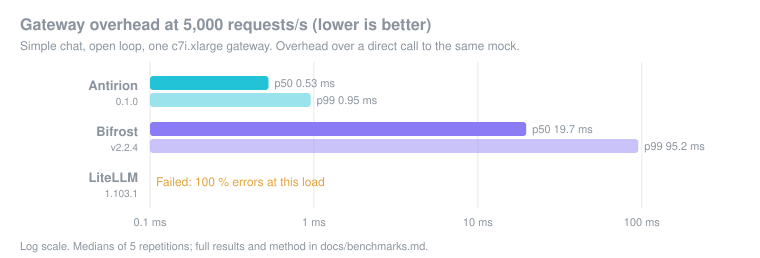
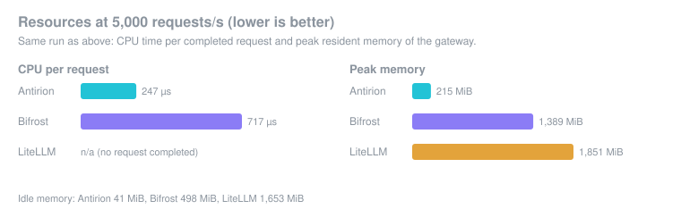
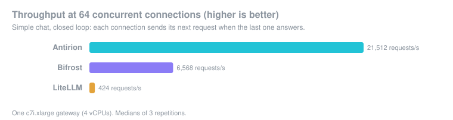

# Source-project benchmark notes

These figures and the method below are the published Antirion benchmark that the gateway console and feature set were ported from. They are not WowRouter's measurements. WowRouter's own local benchmark, harness, and numbers are in [docs/benchmarks.md](../benchmarks.md) and `bench/`.

# Benchmarks

How fast Antirion is, measured against two other open-source AI gateways,
[Bifrost](https://github.com/maximhq/bifrost) and [LiteLLM](https://github.com/BerriAI/litellm), on
machines anyone can rent. Everything that produces the numbers is in this repository: the harness
(`bench/`), the comparison targets with their pinned versions and configurations
(`bench/targets/`), and the AWS orchestration (`bench/aws/`). This page says what is measured, how,
and how to run it yourself. The benchmark is the one place in the repository that names other
products.

- [The headline](#the-headline)
- [What is measured](#what-is-measured)
- [How it is measured](#how-it-is-measured)
- [Scenarios and cells](#scenarios-and-cells)
- [Targets, versions and configurations](#targets-versions-and-configurations)
- [Reproducing the results](#reproducing-the-results)
- [Shards: a faster comparison](#shards-a-faster-comparison)
- [Cost and time](#cost-and-time)
- [Results](#results)
- [Files](#files)

## The headline

**Cell H1: simple chat at 5,000 requests per second.** An OpenAI Chat Completions request
(scenario S1) sent open loop at a fixed 5,000 RPS to each gateway on the same 4 vCPU machine
(c7i.xlarge), with the gateway's minimal profile (P-min: one key checked on every request, no
request logging, no cache, no limits), against a mock upstream that answers at once (latency profile
L0). Each gateway runs 5 repetitions of a 10 s warm-up and a 30 s measurement, interleaved with the
others, and the report gives the median of the repetitions.

With an upstream that adds no latency of its own, the time a request spends in the gateway is
nearly all of what the client waits for beyond the network, so the overhead percentiles show the
gateway's own cost directly.

H1 sits next to **C20**, the same 5,000 RPS of S1 against an upstream that takes 1.5 s
(mock profile L1500), on burstable t3.xlarge and t3.medium machines: the setup of a benchmark one of
the other gateways published. C20 stays in the matrix unchanged, so that setup can be reproduced
(`run.sh --topology t3`). It is not the headline, for three reasons:

- with 1.5 s upstream latency, the overhead is a fraction of a percent of the latency, and the
  direct run's own p99 sits at the edge of the validity bound (scripted delay + 1 ms), so on t3 its
  repetitions come out invalid;
- t3 machines are burstable (CPU credits, a share of a physical core), so the gateway's CPU budget
  depends on the credit state and the neighbours, not on the gateway;
- at 7,500 requests in flight it measures holding connections open more than processing requests.

H1 keeps C20's load and request and moves it to a fixed-performance machine with an upstream that
does not hide the gateway. H1 is a separate cell rather than a variant of C20 (`C20.L0`) because
C20's variants are tied to the t3 topology and to C20's gates.

## What is measured

Every repetition of a cell is two runs at the same rate and with the same request: through the
gateway, then straight to the mock (the *direct* run). The report compares them.

| Metric | Meaning |
| --- | --- |
| overhead p50 / p99 / p99.9 (`overhead_us`) | the gateway run's latency percentile minus the direct run's at the same percentile, in µs |
| TTFT overhead (`ttft_overhead_us`) | for streams: the same difference on the time to the first content event; `inter_event_overhead_us` does it for the gaps between events |
| latency (`latency_us`) | measured from each request's *scheduled* send time to its last byte, so queueing in front of a slow gateway counts (no coordinated omission) |
| achieved RPS | completed requests per second of the measurement window |
| errors | non-2xx answers by status, connect errors, timeouts, broken bodies; `success_fraction` |
| saturation (`saturation_rps`) | for ladders: the highest rate at which a step passes, where a step passes when it achieves at least 99.5 % of the offered rate with at most 0.01 % errors and a p99 overhead of at most 5 ms |
| CPU µs per request (`cpu_us_per_request`) | the CPU time of the gateway's processes and their children (all of LiteLLM's workers) per completed request |
| RSS idle / peak (`rss_bytes.idle`, `rss_bytes.peak`) | resident memory of the same processes: three samples once the gateway is ready and before load, and the highest sample during the gateway run |

A cell's figure is the median over its repetitions; `summary.json` in each target's directory also
holds the minimum and the maximum.

## How it is measured

### Machines

The reference topology `ref-4`, on AWS:

| Role | Instance | What runs there |
| --- | --- | --- |
| generator | c7i.4xlarge (16 vCPU) | `antirion-bench`: the open-loop load generator (16 workers, up to 8,192 connections) and the orchestration of the cells |
| mock | c7i.4xlarge (16 vCPU) | `antirion-bench-mock`: OpenAI and Anthropic answers from pre-rendered bodies, latency scripted per profile (16 workers) |
| gateway | c7i.xlarge (4 vCPU) | the gateway under test, one at a time, started by the harness's agent |

- **Isolation:** each role has a machine of its own, so the generator and the mock never take CPU from the gateway.
- **Placement:** all machines run in one availability zone and one cluster placement group.
- **Image and settings:** every machine boots the same Ubuntu 24.04 image and gets the same system
  settings before anything runs: open files 1,048,576, `somaxconn` 65535, `ip_local_port_range`
  1024–65535 with the benchmark's listen ports reserved, `tcp_tw_reuse` 1, and the `performance`
  CPU governor where the hypervisor exposes one.
- **Recording:** the settings are read back from each machine into the run's inventory
  (`inventory/settings.txt` says whether they are identical on all of them), together with the
  instance type, CPU model, kernel and the steal time over 5 s.

### Procedure

- **Interleaving:** per cell and per repetition, each target runs in turn: Bifrost, LiteLLM, then
  Antirion. Drift of the machines over the run therefore reaches every target alike.
- **Fresh processes:** the harness starts each target fresh for every repetition (Bifrost and
  LiteLLM through their `start.sh`, Antirion from the binary under test with the cell's profile),
  waits for its readiness endpoint and a settle time, runs the gateway run and then the direct run,
  and stops it.
- **Medians:** five repetitions for H1, and the report takes the median of each metric.
- **Self-test:** before the cells, each lane checks its generator and mock on their own (see
  [The self-test on AWS](#the-self-test-on-aws)). Each phase also records the connect round trip to
  the mock (`rtt.txt`).

### Validity

A repetition is **invalid**, and the report shows why, when any of these hold:

- more than 0.1 % of the gateway run's or the direct run's requests left the generator more than
  1 ms after their scheduled time (the generator could not keep the schedule);
- the generator or the mock used more than 60 % of its machine's CPU in either run;
- the direct run's p99 is above the mock's scripted delay plus 1 ms (the path to the mock is not
  clean enough to subtract);
- the direct run completed less than 99.5 % of the requests it offered;
- no request fell in the measurement window, or the harness was built without optimisations.

A cell is valid only when all its repetitions are. A gateway that cannot keep up at 5,000 RPS
does not make a repetition invalid: its requests queue and time out, and that shows as errors, a
lower achieved rate and a higher latency, which is a result.

### The self-test on AWS

Each lane starts with `antirion-bench selftest`, which checks among other things:

- **mock-latency:** S1 sent straight to the mock at 50,000 RPS over 30 s must come back with a p99 of
  at most 50 µs.
- **generator-schedule:** at most 0.1 % of the requests leave more than 1 ms late, and the
  generator stays under 60 % CPU.

On c7i in one cluster placement group, the first check fails, and the reason is the network:

| Lane | Generator / mock | mock-latency p99 | generator-schedule | TCP connect p50 / p99 |
| --- | --- | --- | --- | --- |
| A | c7i.4xlarge / c7i.4xlarge | 1,036 µs | ok: 0.000 % late, 12 % CPU | 231 / 537 µs |
| B | c7i.4xlarge / c7i.4xlarge | 1,044 µs | ok: 0.000 % late, 12 % CPU | 233 / 487 µs |
| C | c7i.8xlarge / c7i.8xlarge | 1,254 µs | ok: 0.000 % late, 6 % CPU | 398 / 787 µs |

The round trips are those in `rtt.txt`, which the harness measures with bare TCP connects. Every
request was answered (1,500,000 of 1,500,000), and the generator kept its schedule. A TCP connect
between the two machines, with no mock work at all, already takes 0.5–0.8 ms at p99. Doubling the
mock's machine and workers (lane C) did not bring the p99 down.

The 50 µs bound is a same-machine bound: `topologies/laptop.yaml` states it as *50 µs at 50,000
RPS on the mock's own machine*. Measured from a generator on another host, it cannot hold on EC2,
whatever the mock's workers or `somaxconn`. This does not touch what the comparison measures:

- the overhead subtracts each repetition's own direct run;
- each repetition still has to pass the [validity rules](#validity), among them a direct-run p99
  within the scripted delay plus 1 ms.

The bound stays as the topology states it; changing it is a decision about the reference, not
about one run. What the orchestrator does instead:

- **The cells still run.** They run after the self-test whatever it says.
- **The failure is shown.** `run.sh` writes every failed or missing check into the
  `not_publishable` list of each `run.json` that lane produced, so the reports print it under
  **Not publishable**.
- **A summary is kept.** `selftest.txt` in the results sums it up.

### Reference and not

Only results from a topology marked `reference: true`, measured with an optimised harness and the
standard windows, are publishable; the report prints **Not publishable** with the reason otherwise.

The t3 mode (`run.sh --topology t3`) renders its topologies with `reference: false`, so its results
are never publishable:

- **Burstable CPU:** t3 instances run on CPU credits in unlimited mode. A vCPU's baseline is 40 % on
  t3.xlarge and 20 % on t3.medium, and the rest is borrowed from a shared host.
- **No placement group:** the t3 mode does not place its machines in a cluster placement group.

The t3 mode is there to reproduce a setup another gateway published, not to rank anything.

## Scenarios and cells

The matrix is data: `bench/matrix/scenarios.yaml` and `bench/matrix/cells.yaml`. The scenarios the
comparison uses:

| Scenario | Request |
| --- | --- |
| S1 | OpenAI Chat Completions, small body (`corpus/data/chat_small.json`) |
| S2 | Chat Completions, large body |
| S3 | Chat Completions, streamed |
| S4 | Anthropic Messages |
| S8 | S1 with an unknown key (expects a rejection, no upstream call) |
| S8-404 | S1 for an unknown model (expects a rejection, no upstream call) |
| M1 | a seeded mix: 60 % S1, 15 % S3, 10 % S4, 5 % S5, 5 % S6, 5 % S2 |

The comparison's cells, in run order:

| Cell | What | Load | Windows |
| --- | --- | --- | --- |
| **H1** | **simple chat, the headline** | **S1, open loop, 5,000 RPS, mock L0** | **10 s + 30 s, 5 reps** |
| cmp-C1 | simple chat | S1, 10,000 RPS | 5 s + 15 s, 3 reps |
| cmp-C2 | simple chat, light | S1, 1,000 RPS | 5 s + 15 s, 3 reps |
| cmp-C4 | Anthropic Messages | S4, 5,000 RPS | 5 s + 15 s, 3 reps |
| cmp-C5 | large bodies | S2, 1,000 RPS | 5 s + 15 s, 3 reps |
| cmp-C8 | streaming, TTFT | S3, 1,000 RPS, mock LS (200 ms to the first event, then one every 20 ms) | 5 s + 15 s, 3 reps |
| cmp-C11 | saturation, simple chat | S1 ladder from 500 RPS, +2,500 then +500 | 5 s + 7 s a step, 1 rep |
| cmp-C13 | saturation, mixed traffic | M1 ladder, the same steps | 5 s + 7 s a step, 1 rep |
| cmp-C16 | idle memory | no load | 3 reps |
| cmp-C17 | memory under many requests in flight | S1, 5,000 RPS, mock L1500 | 5 s + 15 s, 3 reps |
| cmp-C21.401 | rejection of an unknown key | S8, 20,000 RPS | 5 s + 15 s, 3 reps |
| cmp-C21.404 | rejection of an unknown model | S8-404, 20,000 RPS | 5 s + 15 s, 3 reps |
| cmp-C32.c64 | closed loop | S1, 64 concurrent clients | 5 s + 15 s, 3 reps |

Every comparison cell runs at P-min, on every target. `bench/aws/gen-cells.py` derives them from
the matrix: H1 with its own windows, the `cmp-*` cells as the matrix's cells with the comparison's
shorter windows and no pass conditions (gates belong to Antirion's release cells).

On request, the orchestrator also runs Antirion's release checks, on Antirion only:

- **`--with-gates`:** the 27 release cells at 5 repetitions on lane A, after its share of the
  comparison.
- **`--lanes B`:** C7, a three-node cluster with PostgreSQL and Valkey, S1 at 10,000 RPS.
- **`--lanes C`:** C15, the scaling ladder on a 16 vCPU gateway (`ref-16`).

These are release checks, not comparisons.

## Targets, versions and configurations

| Target | Version | Where it comes from |
| --- | --- | --- |
| Antirion | the binary under test (its `--version` and commit are in every `run.json`) | the `binaries` artifact of the CI build, or a local Linux build |
| Bifrost | `transports/v2.2.4` | the release binary for Linux x86_64, checked against a pinned SHA-256 (`bench/targets/bifrost/setup.sh`) |
| LiteLLM | `1.103.1` | `litellm[proxy]==1.103.1` from PyPI, in a uv virtual environment on Python 3.12 (`bench/targets/litellm/setup.sh`) |

Each target directory holds the start script, the configuration template and the target's entry in
the interleaved targets file (`target.yaml`). Bifrost's directory also holds the pricing datasheet
and model parameters it loads at startup, as dated snapshots. The configurations, as they are:

| | Antirion (P-min) | Bifrost | LiteLLM |
| --- | --- | --- | --- |
| request logging | off (`request_logs.enabled: false`) | off (`enable_logging: false`, `disable_content_logging`, no logs store) | off (no database: no spend or request logs; `disable_spend_logs`, `disable_error_logs`) |
| cache | none configured | none (no plugin configured) | none (no `cache` setting) |
| key check on every request | one virtual key | one virtual key (`enforce_auth_on_inference`), allowed only the upstream model | the master key (virtual keys need a database) |
| workers and pools | its defaults; no tuning beyond the profile | `initial_pool_size` 15000, per-provider `buffer_size` 20000 and `concurrency` 10000 (on 4+ vCPUs), as in Bifrost's own published t3 benchmark; `drop_excess_requests: false` | one worker per vCPU (`--num_workers 4`); no pool setting, its defaults |
| retries | none configured | none configured | `num_retries: 0` |
| upstream timeout | its default | 60 s | 60 s |
| log level | the default | `error` | `ERROR` |
| metrics | Prometheus endpoint on (part of P-min) | none configured | none configured |
| startup fetches | none | none (datasheet and parameters from local files) | none (`LITELLM_LOCAL_MODEL_COST_MAP`), telemetry off |

What "fair" means here:

- **Same work.** Every gateway authenticates every request and forwards it to the same mock over
  plain HTTP, with nothing configured that the others lack: no logging, caching, retries or
  guardrails. Where one of them must authenticate differently (LiteLLM without a database has only
  its master key), the cheaper path goes to the other gateway, not to Antirion.
- **Enough capacity.** Bifrost's pool and queue sizes are the ones its authors used for their own
  benchmark, set above the requests in flight, so its queueing never caps the load. LiteLLM gets a
  worker per vCPU.
- **Same conditions.** Same machine, same schedule, a fresh process each repetition, interleaved.
- **Nothing weakened.** A feature a gateway lacks makes the cell `n/a` for it; the cell is not
  changed to fit.

## Reproducing the results

### Prerequisites

- **An AWS account** whose credentials the AWS CLI can use (`aws login`, SSO, or access keys), with
  a default VPC in the region (us-east-1 unless `AB_REGION` says otherwise). The credentials need:
  - EC2: run, describe and terminate instances; create and delete security groups (with ingress
    rules), key pairs and placement groups; describe availability zones, instance type offerings,
    subnets, VPCs and volumes; create tags;
  - `ssm:GetParameter` (the Ubuntu image ID);
  - `servicequotas:GetServiceQuota`;
  - `sts:GetCallerIdentity`.
- **On-demand vCPU quota.** The quota L-1216C47A, *Running On-Demand Standard (A, C, D, H, I, M, R, T, Z) instances*,
  must cover the plan's peak: 36 vCPUs a comparison shard, 252 for `--deadline 45m` (7 shards), 176 for `--lanes A,B,C --with-gates`.
  `--plan` checks it.
- **Tools** on the machine that orchestrates (macOS or Linux):
  - the AWS CLI v2;
  - `gh`, logged in, to download the CI binary;
  - the Rust toolchain (`rustup`; `rust-toolchain.toml` pins the version);
  - `cargo-zigbuild` (`cargo install cargo-zigbuild`) and `zig`, to build the harness for Linux;
  - [`uv`](https://docs.astral.sh/uv/), for `gen-cells.py`;
  - `python3`, `openssl`, `curl`, `ssh`, `scp`, `tar`, `shasum` and `strings`.

Every command below runs from the repository root.

### 1. Get the gateway binary

The binary under test is the CI build's: the `binaries` artifact of the `pr.yml` workflow holds the
Linux x86_64 release binary `antirion` at its root. The artifact is kept 7 days.

```sh
RUN_ID=$(gh run list -R eliasbiondo/antirion -w pr.yml -b main -s success -L 1 --json databaseId -q '.[0].databaseId')
gh run download "$RUN_ID" -R eliasbiondo/antirion -n binaries -D bench/aws/.build/ci
ls -l bench/aws/.build/ci/antirion
```

A local build works too, on a Linux x86_64 machine (`cargo build --release --locked -p antirion`,
then `target/release/antirion`). The gateway's jemalloc does not cross-link with zig, so on macOS
use the CI binary.

### 2. Build the bundle

```sh
GATEWAY_BIN=bench/aws/.build/ci/antirion GATEWAY_COMMIT=<the commit CI built> bench/aws/build-bundle.sh
```

- **What it does:**
  - cross-builds the harness and the mock for Linux (glibc 2.35, so Ubuntu 22.04 and later load them);
  - builds a native `antirion-bench` for the reports;
  - generates the cell files and packs `bench/aws/.build/ab-bundle.tgz` with a manifest of checksums.
- **What the bundle holds:** the binaries, `bench/matrix`, `profiles`, `topologies` and
  `corpus/data`, every `bench/targets/<name>/` that has a `target.yaml`, the VM scripts and the cell
  files.
- **`REPACK=1`** refreshes the scripts, targets and cell files of an existing bundle without
  building anything.
- **Overrides:** `BUNDLE_OUT` (where the bundle goes), `BUILD_TARGET_ROOT` (the cargo target
  directories, `target/bench-aws` by default), `CARGO_BUILD_JOBS`.

### 3. Sign in and plan

```sh
aws login
bench/aws/run.sh --topology ref --deadline 45m --plan
```

`--plan` creates nothing. It prints:

- the machines;
- each lane's phases with expected and timeout minutes, and each shard's cells;
- the wall time and each lane's dead-man time;
- the peak vCPUs;
- the expected cost and the ceiling, in total and per lane;
- the credentials and how long they last;
- the quota left.

Options of the reference topology (`--topology ref`):

| Option | Effect |
| --- | --- |
| *(none)* | the comparison only: H1 and every `cmp-*` cell, all targets, on one lane-A machine set |
| `--cells compare` | the same as no option |
| `--cells headline` | H1 only |
| `--cells H1,C11,cmp-C13` (or `--only`) | exactly these comparison cells; `C11` stands for `cmp-C11` |
| `--shards N` | split the selected cells over N lane-A machine sets ([Shards](#shards-a-faster-comparison)) |
| `--deadline 45m` | the fewest shards whose plan fits the deadline within the vCPU quota left; refuses when none does |
| `--lanes A,B,C` | the lanes to run: A the comparison (the default), B C7 on a cluster, C C15 on a 16 vCPU gateway |
| `--with-gates` | lane A also runs Antirion's release cells after its share of the comparison |
| `--smoke [--setup]` | one c7i.xlarge through the whole create, ssh and teardown flow, about one cent |

`run.sh --topology t3` runs the t3 reproduction of the published setup: the comparison and C20 on
t3.xlarge and t3.medium. It is never publishable and takes none of the options above.

Environment:

| Variable | Default | Effect |
| --- | --- | --- |
| `AB_REGION` | `us-east-1` | the region to run in |
| `AB_ACCOUNT` | unset | when set, the run refuses credentials for any other account |
| `COST_CAP` | `15` | the run refuses to start above this expected cost, in USD |
| `WALL_MIN` | long enough for every release cell | caps lane A with `--with-gates` |
| `AB_STATE_DIR` | `bench/aws/.state` | where each run's state and ssh key live (gitignored) |
| `AB_RESULTS_DIR` | `bench/results` | where results land (gitignored) |
| `BUNDLE` | `bench/aws/.build/ab-bundle.tgz` | the bundle to upload |

### 4. Run

```sh
mkdir -p bench/aws/.state
nohup bench/aws/run.sh --topology ref --deadline 45m > bench/aws/.state/compare.log 2>&1 &
tail -f bench/aws/.state/compare.log
```

**Before it creates anything,** the run checks:

- the credentials, which must last the planned wall time plus 30 minutes;
- the account, when `AB_ACCOUNT` is set;
- the bundle;
- the expected cost against `COST_CAP`;
- the vCPU quota.

**Then it:**

1. creates a security group (ssh from this machine's address only, everything between members),
   a key pair and a cluster placement group;
2. launches the machines and sets them up: the bundle goes to the first generator, and the other
   machines fetch it from there;
3. starts each lane on its generator under `setsid nohup`;
4. follows the lanes, fetching each one's results and terminating its machines as soon as it ends;
5. renders the reports and tears everything down.

**What protects your account:**

- **Tags:** every resource is tagged `Project=antirion-bench` and `RunId=<id>`.
- **Dead-man switch:** every instance is launched to terminate itself at its lane's planned time
  plus 30 minutes, so a closed laptop or expired credentials cannot leave machines running.
- **Teardown on exit:** the run tears down at the end, on errors and on Ctrl-C.
- **Fresh key:** the ssh key is created for the run under `bench/aws/.state/runs/<id>/`, which is
  gitignored, and deleted once the teardown succeeds.

### 5. Resume

The lanes keep running on their generators even if the orchestrating machine sleeps or its
credentials expire. The run ID is in the first lines of the log and under `bench/aws/.state/runs/`.

```sh
aws login                                     # if the session ended
bench/aws/run.sh --resume <run id>            # follow to the end, fetch, tear down
bench/aws/run.sh --resume <run id> --now      # fetch what is done now, then tear down
```

### 6. Teardown by hand

```sh
bench/aws/teardown.sh <run id>     # everything tagged RunId=<run id>
bench/aws/teardown.sh --all        # everything tagged Project=antirion-bench
aws --region us-east-1 ec2 describe-tags --filters Name=tag:Project,Values=antirion-bench --output text
```

The exit status of `teardown.sh`:

- **0:** every listing answered and nothing tagged remains.
- **1:** something remains.
- **2:** it could not list; it then prints what may be left and the exact commands to remove it.

Terminated instances stay listed for about an hour.

### 7. Results and the report

Results land in `bench/results/<run id>/`:

| Path | What |
| --- | --- |
| `compare/` | the comparison: `comparison.md`, `.html` and `.json` side by side, one directory per target (`run.json`, `summary.json`, `report.md`, a directory per cell and repetition with the raw HDR histograms), `targets.json`, and with shards `shards.json` |
| `compare.report.txt` | the report renderer's output for it |
| `selftest-a/`, `selftest.txt`, `inventory/`, `rtt.txt` | the self-test and its verdict, the machines' inventory and settings, the RTT to the mock |
| `gates/`, `c7-cluster/`, `c15/` | with `--with-gates`, `--lanes B`, `--lanes C` |
| `shards/<lane>/` | with `--shards`, each shard's own output as fetched |
| `plan.txt`, `cost.txt`, `bundle.manifest.json`, `status-<lane>` | the plan, what the machines cost, what was run, how each lane went |

`run.sh` renders the reports itself. To render again, or on another machine:

```sh
cargo run --release --manifest-path bench/Cargo.toml -p antirion-bench -- \
  --bench-dir bench report bench/results/<run id>/compare
```

## Shards: a faster comparison

`--shards N` splits the selected comparison cells over N lane-A machine sets (lanes A, A2 … AN).
Each set has its own generator, mock and gateway, and all of them are in the run's placement group.

- **Choosing N:** `--deadline 45m` picks the fewest shards whose planned wall time fits.
  - It refuses when the quota left cannot hold that many.
  - It also refuses when no number of shards fits: the longest cell sets the floor. H1 alone is
    about 29 minutes, so a comparison with H1 needs about 44 minutes with setup and fetch.
- **Balancing:** cells are assigned longest first, each to the least loaded shard.
  - The durations are the estimates in the bundle's `cells/comparison.tsv`, written by
    `gen-cells.py`.
  - An estimate covers, per target and repetition, a gateway run and a direct run plus 35 s to
    start and stop the target. The open cells of an earlier run took 28–38 s for that start and stop.
  - Saturation ladders are the long cells. Their estimate assumes a climb to 15,000 RPS and every
    fine step after it.
- **What runs where:** every shard interleaves all targets on its own machines, so each cell is as
  fair as without shards.
- **Merging:** at the end, the shards' results are merged into one `compare/`, which
  `antirion-bench report` renders as one comparison.
  - Each target's `run.json` spans the earliest start and the latest end.
  - `compare/shards.json` records which shard ran which cell.
  - Each shard's own output stays under `shards/<lane>/`.
- **Per shard:** the plan shows each shard's cells, timeline and cost, and checks the quota for all
  of them together. Each shard's machines carry its lane (`Lane=A2`) under the run's one `RunId`.
  They get their own dead-man time and are terminated as soon as their shard is done.

**The trade-off.** Shards run on different physical hosts. Within a cell, all targets ran on the
same machines, so comparing targets within a cell is sound. Comparing a cell of one shard with a
cell of another is not, for example H1's overhead against cmp-C1's: that difference mixes the cells
with the hosts. Without shards, every cell ran on one machine set and such cross-cell readings are
at least on the same hardware.

## Cost and time

The figures below are from `--plan` (us-east-1 on-demand prices, a public IPv4 address and 16 GB
of gp3 per machine):

- **Expected:** each machine for its lane's planned time.
- **Ceiling:** every machine until its dead-man switch.

| Command (`run.sh --topology ref …`) | Machines | Peak vCPUs | Wall (planned) | Expected | Ceiling |
| --- | --- | --- | --- | --- | --- |
| `--cells headline` | 3 | 36 | ~44 min | $1.19 | $2.01 |
| *(no option: the comparison)* | 3 | 36 | ~182 min | $4.93 | $5.75 |
| `--shards 2` | 6 | 72 | ~100 min | $5.34 | $6.97 |
| `--shards 3` | 9 | 108 | ~74 min | $5.78 | $8.21 |
| `--shards 4` | 12 | 144 | ~59 min | $6.18 | $9.44 |
| `--deadline 45m` (picks 7 shards) | 21 | 252 | ~44 min | $7.45 | $13.15 |
| `--lanes A,B,C --with-gates` | 13 | 176 | ~284 min | $11.28 | $15.25 |
| `--lanes A,B,C --with-gates --shards 3` | 19 | 248 | ~173 min | $12.50 | $18.09 |
| `--smoke` | 1 | 4 | ~5 min | about $0.01 | |

Notes:

- **What drives the cost:** the c7i.4xlarge generator and mock, at $0.714 an hour each. A shard
  costs about $1.62 an hour.
- **`--with-gates`:** lane A's release cells set the wall time. By default it is long enough for
  all of them (about 95 minutes after the comparison); `WALL_MIN` cuts it shorter.
- **Quota:** the default On-Demand Standard quota of many accounts is lower than 252 vCPUs. With
  less, `--deadline` stops at the shard count the quota holds and says so.
- **`COST_CAP`:** the default cap of $15 applies to the expected cost.
- **The t3 mode:** see its own `--plan`.

## Results

Reference run `aws-20261018t0107-3a9d` on 2026-10-18 (us-east-1; c7i.xlarge gateway, c7i.4xlarge generator and mock, one placement group; 7 shards). Cell C21.401 comes from the rerun `aws-20261018t0157-253e`, after the failed-authentication throttle was set in P-min. Versions: Antirion 0.1.0, Bifrost v2.2.4, LiteLLM 1.103.1. The curated results (tables, per-cell summaries, plan, system settings, self-test) are in [`bench/published/2026-10-18-c7i/`](../bench/published/2026-10-18-c7i/compare/comparison.md); `bench/aws/charts.py` draws the charts from them.

### H1: simple chat at 5,000 RPS

Latency is the gateway's overhead over a direct call to the same mock; medians of 5 repetitions.

| Gateway | p50 | p99 | p99.9 | Achieved RPS | Errors | CPU per request | RSS idle | RSS peak |
| --- | --- | --- | --- | --- | --- | --- | --- | --- |
| Antirion | 0.53 ms | 0.95 ms | 1.18 ms | 5,000 | 0 % | 247 µs | 41 MiB | 215 MiB |
| Bifrost | 19.7 ms | 95.2 ms | 119.4 ms | 5,000 | 0 % | 717 µs | 498 MiB | 1,389 MiB |
| LiteLLM | — | — | — | 0 | 100 % | — | 1,653 MiB | 1,851 MiB |







### Every cell

**C1: S1 10000 RPS**

| Gateway | p50 | p99 | p99.9 | Achieved RPS | Errors | CPU per request | RSS idle | RSS peak |
| --- | --- | --- | --- | --- | --- | --- | --- | --- |
| Antirion | 0.61 ms | 1.50 ms | 3.05 ms | 10,000 | 0 % | 176 µs | 41 MiB | 295 MiB |
| Bifrost | 12.1 s | 19.1 s | 19.5 s | 10,000 | 0 % | 399 µs | 514 MiB | 3,283 MiB |
| LiteLLM | — | — | — | 0 | 100 % | — | 1,653 MiB | 1,850 MiB |

**C2: S1 1000 RPS**

| Gateway | p50 | p99 | p99.9 | Achieved RPS | Errors | CPU per request | RSS idle | RSS peak |
| --- | --- | --- | --- | --- | --- | --- | --- | --- |
| Antirion | 0.76 ms | 0.95 ms | 1.02 ms | 1,000 | 0 % | 351 µs | 41 MiB | 87 MiB |
| Bifrost | 0.72 ms | 1.16 ms | 2.65 ms | 1,000 | 0 % | 897 µs | 517 MiB | 815 MiB |
| LiteLLM | 9.1 s | 29.1 s | 29.8 s | 719 | 28 % | 5,399 µs | 1,655 MiB | 1,855 MiB |

**C4: S4 5000 RPS**

| Gateway | p50 | p99 | p99.9 | Achieved RPS | Errors | CPU per request | RSS idle | RSS peak |
| --- | --- | --- | --- | --- | --- | --- | --- | --- |
| Antirion | 0.81 ms | 1.93 ms | 6.66 ms | 5,000 | 0 % | 417 µs | 41 MiB | 210 MiB |
| Bifrost | 2.50 ms | 70.0 ms | 85.4 ms | 5,000 | 0 % | 661 µs | 500 MiB | 1,401 MiB |
| LiteLLM | 29.3 s | 30.0 s | 30.0 s | 35 | 99 % | 109,415 µs | 1,655 MiB | 1,806 MiB |

**C5: S2 1000 RPS**

| Gateway | p50 | p99 | p99.9 | Achieved RPS | Errors | CPU per request | RSS idle | RSS peak |
| --- | --- | --- | --- | --- | --- | --- | --- | --- |
| Antirion | 0.93 ms | 1.17 ms | 1.34 ms | 1,000 | 0 % | 623 µs | 41 MiB | 88 MiB |
| Bifrost | 1.48 ms | 27.2 ms | 38.3 ms | 1,000 | 0 % | 2,335 µs | 507 MiB | 1,133 MiB |
| LiteLLM | 10.2 s | 29.2 s | 29.9 s | 653 | 35 % | 6,050 µs | 1,653 MiB | 2,064 MiB |

**C8: S3 1000 RPS (LS)**

| Gateway | p50 | p99 | p99.9 | Achieved RPS | Errors | CPU per request | RSS idle | RSS peak |
| --- | --- | --- | --- | --- | --- | --- | --- | --- |
| Antirion | 0.51 ms | 0.51 ms | 0.51 ms | 1,000 | 0 % | 1,425 µs | 41 MiB | 198 MiB |
| Bifrost | 12.3 ms | 150.5 ms | 184.3 ms | 1,000 | 0 % | 3,585 µs | 507 MiB | 1,317 MiB |
| LiteLLM | 21.3 s | 28.9 s | 29.0 s | 182 | 82 % | 21,120 µs | 1,652 MiB | 1,986 MiB |

**C11: S1 saturation ladder**

| Gateway | p50 | p99 | p99.9 | Achieved RPS | Errors | CPU per request | RSS idle | RSS peak |
| --- | --- | --- | --- | --- | --- | --- | --- | --- |
| Antirion | 0.61 ms | 2.73 ms | 8.28 ms | 14,000 (saturation 14,000) | 0 % | 199 µs | 40 MiB | 373 MiB |
| Bifrost | 0.56 ms | 2.54 ms | 5.05 ms | 3,500 (saturation 3,500) | 0 % | 717 µs | 500 MiB | 1,118 MiB |
| LiteLLM | — | — | — | — | — | — | 1,680 MiB | — |

**C13: M1 saturation ladder**

| Gateway | p50 | p99 | p99.9 | Achieved RPS | Errors | CPU per request | RSS idle | RSS peak |
| --- | --- | --- | --- | --- | --- | --- | --- | --- |
| Antirion | 0.80 ms | 4.34 ms | 9.22 ms | 6,000 (saturation 6,000) | 0 % | 454 µs | 41 MiB | 900 MiB |
| Bifrost | — | — | — | — | — | — | 509 MiB | — |
| LiteLLM | — | — | — | — | — | — | 1,695 MiB | — |

**C16: no load**

| Gateway | p50 | p99 | p99.9 | Achieved RPS | Errors | CPU per request | RSS idle | RSS peak |
| --- | --- | --- | --- | --- | --- | --- | --- | --- |
| Antirion | — | — | — | — | — | — | 41 MiB | 41 MiB |
| Bifrost | — | — | — | — | — | — | 504 MiB | 504 MiB |
| LiteLLM | — | — | — | — | — | — | 1,662 MiB | 1,662 MiB |

**C17: S1 5000 RPS (L1500)**

| Gateway | p50 | p99 | p99.9 | Achieved RPS | Errors | CPU per request | RSS idle | RSS peak |
| --- | --- | --- | --- | --- | --- | --- | --- | --- |
| Antirion | 0.00 ms | 0.00 ms | 6.14 ms | 5,000 | 0 % | 230 µs | 41 MiB | 1,196 MiB |
| Bifrost | 6.7 s | 10.5 s | 10.7 s | 5,000 | 0 % | 495 µs | 509 MiB | 3,244 MiB |
| LiteLLM | — | — | — | 0 | 100 % | — | 1,656 MiB | 1,951 MiB |

**C21.401: S8 20000 RPS**

| Gateway | p50 | p99 | p99.9 | Achieved RPS | Errors | CPU per request | RSS idle | RSS peak |
| --- | --- | --- | --- | --- | --- | --- | --- | --- |
| Antirion | 0.30 ms | 0.75 ms | 0.88 ms | 20,000 | 0 % | 61 µs | 41 MiB | 47 MiB |
| Bifrost | 1.9 s | 2.5 s | 2.5 s | 20,000 | 0 % | 199 µs | 509 MiB | 2,108 MiB |
| LiteLLM | — | — | — | 0 | 100 % | — | 1,654 MiB | 2,269 MiB |

**C21.404: S8-404 20000 RPS**

| Gateway | p50 | p99 | p99.9 | Achieved RPS | Errors | CPU per request | RSS idle | RSS peak |
| --- | --- | --- | --- | --- | --- | --- | --- | --- |
| Antirion | 0.57 ms | 1.27 ms | 1.51 ms | 20,000 | 0 % | 39 µs | 38 MiB | 60 MiB |
| Bifrost | 17.7 s | 27.4 s | 27.5 s | 20,000 | 0 % | 200 µs | 512 MiB | 2,947 MiB |
| LiteLLM | — | — | — | 0 | 100 % | — | 1,657 MiB | 2,434 MiB |

**C32.c64: S1 closed loop, 64 connections**

| Gateway | p50 | p99 | p99.9 | Achieved RPS | Errors | CPU per request | RSS idle | RSS peak |
| --- | --- | --- | --- | --- | --- | --- | --- | --- |
| Antirion | 2.80 ms | 6.15 ms | 10.6 ms | 21,512 | 0 % | 185 µs | 41 MiB | 385 MiB |
| Bifrost | 7.88 ms | 32.1 ms | 42.0 ms | 6,568 | 0 % | 606 µs | 518 MiB | 1,068 MiB |
| LiteLLM | 132.2 ms | 488.4 ms | 568.6 ms | 424 | 0 % | 9,018 µs | 1,655 MiB | 1,786 MiB |

### Reading the validity flags

The harness's validity rules were written for a mock on the generator's host. Across machines in a
placement group a plain TCP connect already takes about 0.5–0.7 ms at p99 (`rtt.txt`), so on this
topology the mock self-test (p99 ≤ 50 µs at 50,000 RPS) fails and most cells are flagged "direct p99
above the scripted delay + 1 ms". Those flags concern the network floor every target shares, not a
target: each cell ran all three gateways interleaved on the same machines, and each overhead is
measured against the direct run of that same cell. `selftest.txt` and each target's `report.md`
list every flag.

## Files

| Path | What |
| --- | --- |
| `bench/aws/run.sh` | the orchestrator: plan, run, resume, smoke |
| `bench/aws/teardown.sh` | deletes a run's resources by tag and checks nothing is left |
| `bench/aws/build-bundle.sh` | builds the bundle |
| `bench/aws/gen-cells.py` | writes the cell files and the comparison's estimates from the matrix |
| `bench/aws/vm/` | what runs on the machines: `setup.sh` (system settings, agent, targets' setup), `render.sh` (topology and targets files from the machines' addresses), `targets.sh`, `lane.sh` (a lane's phases), `smoke.sh` |
| `bench/targets/bifrost/`, `bench/targets/litellm/` | the comparison targets |
| `bench/targets/external/README.md` | how the harness drives any external target |
| `bench/matrix/`, `bench/profiles/`, `bench/topologies/` | the cells, the gateway profiles and the topologies |
